The deployed system and the proposed semantic layer are separate. The automatic builder generates the bank workflow from the brief and original API. Its fixed AGENT_LLM extracts event candidates; deterministic state, policy and receipt logic decide what can happen. V11 is an offline lossless parser and feature adapter. It has **no new trained weights, no qualified data support, no runtime integration and no bank authority**.

```mermaid
flowchart TB
  subgraph D["Deployed automatic workflow — source guards still under repair"]
    S["Brief + original API"] --> B["Automatic builder / compiler"]
    B --> L["Fixed AGENT_LLM: event candidates"]
    L --> R["Typed turn + per-target facts"]
    B --> P["Deterministic policy graph + preflight"]
    R --> P
    P --> T["Permitted bank tools"]
    T --> O["Receipts: success / failure / unknown"]
    O --> R
  end
  subgraph H["Offline SHADOW — no bank-tool or permission path"]
    A["Independent TRAIN sources + lineage closure"] --> V["V11 lossless AST + scoped source features"]
    V --> M["Eligibility + separate semantic masks"]
    M --> C["Future admitted CPU heads + rule ablations"]
    C --> Q["Post-freeze calibration / risk / blind OOD"]
  end
```

The LLM's extracted copy of speech is not authenticated raw-user evidence. Fixture flags, a source ID/hash, valid context symbols or a model score cannot prove customer identity, current component versions or consent. Any future proposal integration needs an original-runtime ingress/dependency contract and must retain deterministic policy obligations.

The policy graph must preserve all acts and component facts before selecting a primary response. Expand targets and validate the entire financial plan before intended writes; apply correction edges in their source order, scope withdrawal/pause/refusal properly, and bind consent to the current completed spoken readback and per-component versions. Classify tool receipts explicitly: unknown or stale results cannot support success claims or automatic replay. Multiple remote calls do not become an atomic bank transaction merely because local preflight passed.

**What was actually verified.** Frozen V11 reports 160 checks/533 assertions and 108 portable JSON comparisons. Four fresh closure cases confirm both checkpoint18 fixes: quoted lexical mentions no longer govern a later proposal, a separate admin question does not turn the earlier financial directive into a question, and structured context fields are rejected. Finite grammar, unsupported predicates and source-role features remain weak hypotheses. These checks do not establish broad semantic competence, privacy or deployment safety.

V11 scanned 132 raw TRAIN rows and produced 95 A3 hypotheses; 36 governor hypotheses changed. No annotation labels were read in that diagnostic, so no new accuracy, precision, recall or unmatched-truth score exists. The six-case slot-removal check was a feature operation, not a trained ablation. All 132 outputs abstain, new usable primary/DATE support is zero, and no new fit/GPU work occurred.

The context adapter accepts bounded scalar symbols or explicit unknown, following the frozen source-loader string fields. It is not a bank-policy enum. Symbol validity cannot admit the 60 unknown peer profiles. The raw parser file is 43,554 bytes (42,827 after CRLF normalization), imports only re and contains zero coefficients; the future complete inference bundle, including model/vocabulary/decoder, must stay within 500,000 bytes.

**Current runtime evidence, from the parent.** A9 original: 26/30 combined calls, 28/30 bank calls, 6/10 cases passing all three repetitions. B14 original: 9/9 and 3/3 all-three, with collective-exclusion issues still found in 302 conditional CPU source observations. A-next5 had 50/52 source checks with branch-hours/availability issues; its first original 30 calls were active when this handoff was written. Source witness counts are not provider occurrence frequencies. There is no clean deployment claim.

**Do next, in this order.**

1. Close actual ancestry and source-profile/schema evidence. Union shared source/template roots, aliases, variants and masked relatives; unresolved components cannot be recounted as independent data.
2. Freeze parser/schema/scoped feature hashes. Generate actual runtime candidates/features before joining independently reviewed TRAIN labels. Missing detection/label is masked, not negative. DATE language completion stays separate from relevance/maximality, target, polarity, reference/value resolution and financial permission.
3. Admit the smallest useful CPU pilot only when real per-class support and parent source-bound fit authorization exist. Old V5 primary 27/19 and DATE 20/16 counts do not automatically transfer to V11; the unchanged floor 20 must also hold in each training fold used for comparison.
4. Fit two independently masked sparse binary heads: dominant new proposal versus existing-offer/admin/info/permission alternatives, and maximal DATE complete versus unfinished. Use group→turn→candidate mean masked BCE. Compare finite rules, phase-only, text-only, text+context, full derived-governor and governor-removed features on identical canonical-root folds. A randomized-label control must actually change labels while keeping variants together.
5. Report actual-pipeline OOF loss/errors/coverage/abstention separately from oracle-span diagnostics, plus native/export parity, complete bundle size and cold-load/per-turn CPU latency. OOF selection is exploratory. After freeze, collect distinct calibration-fit, risk and later blind/OOD roots; exposed diagnostics cannot become blind qualification. Independent machine reviewers are evidence, not human/IID truth.
6. Keep bank-authority checks and original end-to-end bank scores separate from semantic-model metrics. No trained score can override a failed identity, policy, freshness or receipt obligation.

Stop parser expansion tonight unless a new material failure appears. The next useful evidence is closed data admission and an honest CPU comparison. GPU availability alone supplies no reason to train; lineage, ingress and scope faults require source/data work.

Source pins and exact fresh cases: [checkpoint19 JSON](<C:/Users/9bakl/OneDrive/Belgeler/ChatGPT/BUILD THE BUILDER/fraya/analysis/learned-layer-design.checkpoint19-v11-closure.json>). V11 manifest SHA256: 59f8b180176ac127aecb686f028f9ace71d8a648a476f2e0e97415713cd66778. No frozen artifacts or original expectations were edited.

