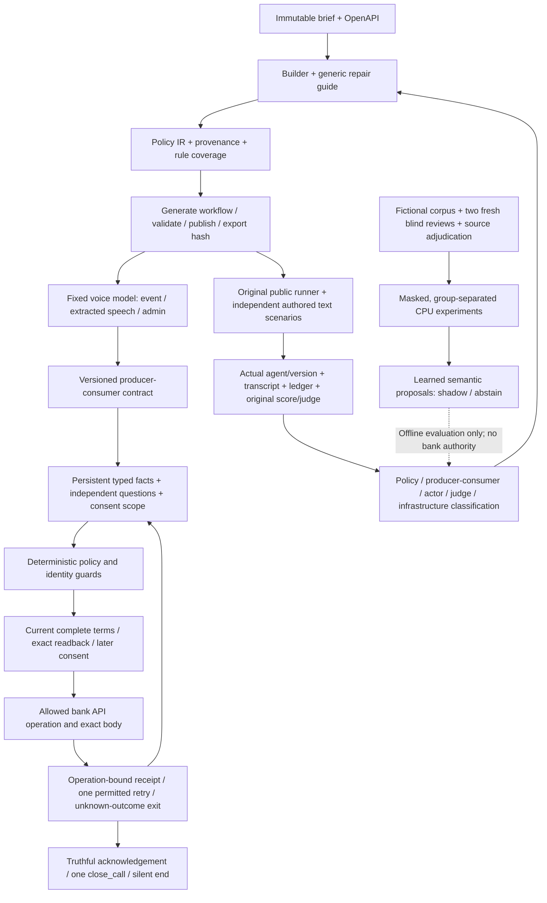

# Night builder architecture — evidence checkpoint

The current deliverable is a compiler that turns a brief and supplied OpenAPI into a published Freya workflow. Source documents and official scoring remain unchanged. The workflow uses the fixed platform model for semantic extraction and deterministic code for identity, policy, consent, API bodies and receipt handling.

A graph can execute flexible semantic decisions while the guards enforce the source policy. The current failure is often agreement between extraction and its consumer rather than insufficient branches. Eighteen A-next1 stress calls extracted recipient confirmation correctly but its exact raw-sentence guard rejected natural self-identification; their later stress conditions were unexercised.

The automatic A7 repair fixes the actual HTTP500 path where the response post-hook did not run: all three bank retries produced the required promise. Its unchanged official combined score is 27/30 and 7/10 cases all three. Two calls still failed recipient interpretation, and one judge rejected the required call-recording disclosure as a premature promise acknowledgement. That failed score is retained.

A-next2 repairs recipient interpretation in a separate version2 slot. B-next3 adds paired question and consent pause/withdrawal handling in a separate version3 slot. Both require hosted evidence; publication and compiler self-checks do not establish pass rates.

The R4 learned prototype proposes date expressions with shared local features and explicit reference, normalization and privacy masks. It detects DATE candidates in all72 new TRAIN rows, covering22 canonical groups; exact reviewed alignment and eligible per-class support remain separate requirements. All learned runtime outputs abstain. No authenticated raw voice ingress, audio/ASR validation or independent statistical qualification has been established.

The parent authorized108 reviewed primary TRAIN rows for CPU engineering experiments only. Ambiguous examples remain masked. The third adjudicator read the reviewers' labels, so its role is isolated source adjudication rather than a blind reviewer. Unknown historical reviewer-A bytes are disclosed. Neither the synthetic labels nor semantic predictions establish correct bank policy.

Modal expenditure is zero. Native Opus found inherited child environments, replayable budget grants and incomplete stop evidence in the original offline adapter. A separate hardened adapter must pass review before any remote experiment; CPU authorization does not authorize a GPU launch. The target is30USD, aggregate cap35USD, initial experiment envelope10USD, at most one GPU job and three lifetime start attempts.

