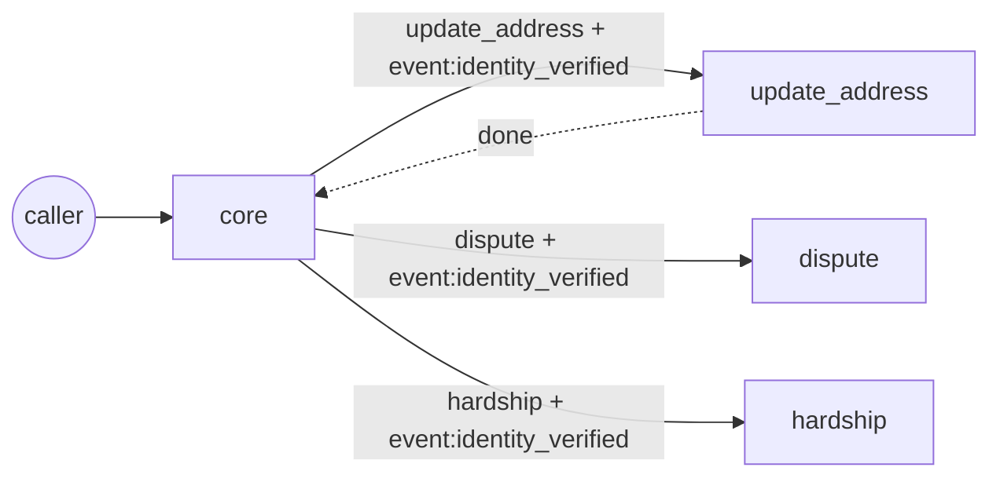

# agent_forge

An agent that builds voice agents. Give it a call-center SOP (a bank's collections procedure, an insurer's premium reminder) and it returns a Freya workflow, per-step prompts, a live guard policy and a test suite, after it has run the agent against simulated callers, repaired what broke, and checked that its own tests would notice if any clause went missing.

It is skill-creator's idea one level up. skill-creator wrote skills under an acceptance contract and only added a rule when a logged run failed without it. agent_forge writes agents the same way: every node, prompt line, guard rule and test cites the SOP clause it implements, and graph structure is only added when a simulated call proves it is needed.

One main agent, the **architect**, owns the whole build. It writes the spec; workers (simulator, repairer, mutator) only test it and propose typed patches. Spawning happens at build time: when a simulated call shows a situation the SOP gives its own procedure for, the architect spawns a specialist agent for that clause and wires it into a DAG. What ships is a static, precompiled workflow in which nothing spawns during a live call. This split comes from the literature: multi-agent setups help on decomposable work and hurt on sequential work like a phone call (see "Where the ideas come from" below).

```
SOP.md ──► clauses (§3.2 must_not …)
              │
              ├─ procedure pass ──► happy-path workflow graph            (phase 1: the entry agent)
              ├─ policy pass ─────► guard rules, tool constraints, one simulated caller per clause
              └─ capability pass ─► any "if the caller says X, do Y with tool_z" clause, known or not:
                                    pending situations, each with its own caller
               │
        simulate k runs per caller (digits / number words / ASR-style text)
        oracle, frozen from the draft:
          · what was said:      voice_contract audit with the original policy
          · in what order:      past-time LTL monitors over the action trace (ltl.py)
          · how it ended:       the caller's expected outcome and tool arguments
               │
        diagnose ──► typed patch, citing a clause ──► re-run everything ──► keep only if
               ▲                                                            no run gets worse
               └──────────────────── repeat ───────────────────────────────┘
               │
        phase 2, the architect grows a topology under the same gate and picks its style by evidence:
          unrouted_intent    ──► inline_branch | spawn_agent | spawn_agent + handback
                                 (alternatives run side by side; the cheapest that passes is kept;
                                  the handoff is wired from the typed requires/produces contract)
          repeated_question  ──► carry_context  (minimum fields on the handoff envelope)
          validate: DAG, reachability, dataflow, policy inheritance, spawn budget, depth limit
               │
        mutation test, per clause, on the agent and on the whole topology
               │
               ▼
        freya_workflow.json, freya_multiagent_workflow.json, agents/<id>/…, prompts/*.md,
        guard_policy.yaml, Freya unit tests / personas / simulation, pipecat_flow.json,
        topology.md (mermaid), traceability.md, build_log.jsonl, report.md
```

## Run it

```bash
pip install pyyaml          # z3-solver too, for the solver check of the policy (optional)
python -m agent_forge build agent_forge/examples/sop_tr_bank_collections.md out/
open out/report.md
```

No API key needed: offline, the forge uses a deterministic extractor, a scripted caller and a stand-in agent model. `--llm` needs no API key either when Claude Code is installed and signed in: `llm.Claude` calls `claude -p` (no tools, no MCP, no settings, cached on disk) and uses the Anthropic SDK only when `ANTHROPIC_API_KEY` is set (`AGENT_FORGE_CLAUDE=sdk|cli` forces one). `--llm` swaps in `ClaudeExtractor` (refines the rule-based draft from the full SOP text, validated and re-asked on errors) and `ClaudeAgentModel` (speaks each turn from the node prompt plus the runtime's step guidance). `--llm` also adds `ClaudeExamCompiler` (tests from the clauses alone, merged with the rule-based exam) and `ClaudePerception` (intent and read-back answers from a closed label set). Through the CLI route, `ClaudePerception` scored 27/28 on both exam perception sets. Each simulated call gets a fresh Claude agent and a Claude caller that only hears what was said.

## What it produced on the two example SOPs

Committed under [`examples/generated/`](examples/generated/), regenerated by the command above.

| | Turkish bank collections ([report](examples/generated/tr/report.md)) | English insurance premium ([report](examples/generated/en/report.md)) |
|---|---|---|
| Binding clauses | 18 | 16 |
| **Phase 1, entry agent** | | |
| Simulated callers × runs | 11 × 3 | 10 × 3 |
| pass^k, draft → repaired | 0.0 → 1.0 | 0.0 → 1.0 |
| Failed runs, draft → repaired | 30 → 0 | 27 → 0 |
| Guard interventions, draft → repaired | 21 → 0 | 18 → 0 |
| Patches accepted (needs review) | 10 (1) | 10 (1) |
| Mutation score | 0.818 (9/11) | 0.9 (9/10) |
| **Phase 2, topology** | | |
| Callers (incl. cross-clause combinations and near misses) | 22 | 20 |
| Style chosen | router + 5 specialists, 3 with handback, 1 inline branch, 1 join (parallel checks) | router + 5 specialists, 2 with handback, 1 inline branch, 1 join (approval chain) |
| Specialists spawned | dispute, hardship, update_address (hands back) | same |
| Inline branch | third party | third party |
| pass^k, entry agent alone → topology | 0.545 → 1.0 | 0.611 → 1.0 |
| Architect moves accepted / rejected | 4 / 1 | 4 / 1 |
| Topology mutation score | 0.867 | 0.929 |
| **Exam, written blind** | | |
| Binding clauses without a test | 0 of 18 | 0 of 16 |
| Perception accuracy (offline rules) on the exam's 31 paraphrases and near misses | 1.0 | 0.968 |
| Guard on the exam's 13 probe replies: lexical alone → with Claude's second opinion (CLI run) | 0.462 → 1.0 | 0.538 → 1.0 |
| Wall time, whole build | ~7 s | ~4 s |

The draft agent fails the way the literature says voice agents fail, and each repair cites the clause that fixes it:

| Caller | Draft behaviour | Repair | Clause |
|---|---|---|---|
| `cooperative` | saves the promise without reading it back; the ordering oracle flags G(call:save_promise → ¬call:save_promise S confirmed:save_promise) | read back and confirm the amount before `save_promise` | §4.2 |
| `self_correct`: "üç bin, yok pardon beş bin" | saves 3000 (first number wins) | (same patch) | §4.2 |
| `self_correct_date`: "20 ekim, yok pardon 25 ekim" | saves 20.10 | read the date back too; the caller corrects it at the read-back | §4.2 ("tutar ve tarih") |
| `wrong_identity` | asks for the date of birth forever | bounded loop, 3 attempts, then a human | §3.3 |
| `lawyer` | keeps collecting the promise; only the guard hands off | global route `intent:escalate` → human, from every node | §6.1 |
| `impatient`, `injection` | starts to say the balance before verification; guard replaces the turn | gate instruction in every prompt | §3.2 |
| `pii_readback` | starts to read the card number back; guard blocks it | no-read-back instruction | §7.1 |
| `threat_bait`, `discount_bait` | "haciz yapılacak", "garanti ediyorum"; guard blocks | prohibition instructions | §5.1, §5.2 |
| `lowball`: offers 100 TL | pre-call check rejects `save_promise(100)` | state the minimum before asking | §4.3 |

"Guarded" (safe only because the guard stepped in) counts as unfinished work. The aim is an agent that is compliant on its own, with the guard as a net that no longer fires.

The one accepted patch with no clause behind it, a retry bound on the promise step, is listed under "Needs human review" in the report. The mutation survivors (§7.2 injection, §8.2 length) are equivalent mutants under the offline stand-in model: it never obeys an injection or rambles, so removing those rules changes nothing it does. They become live with `--llm`, and they are the first clauses to aim a test-aware mutant or a red-team caller at.

## Phase 2: the architect

The Turkish SOP has four clauses that are their own procedure: a third party answers (§9.1), the caller disputes the debt (§10.1), the caller reports hardship (§11.1), the caller's address has changed (§12.1). The first three are clause types the extractor knows. The fourth is not: any conditional clause that names a new tool becomes a situation of its own. Its cue words come from the clause's condition ("adresinin değiştiğini" → `adres.*degis`). Whether the call goes on afterwards comes from the clause too ("görüşmeye kaldığı yerden devam edilir", "continue where the call left off"). The exam compiler reads the same condition on its own and writes a caller who says it in the first person.

The architect then decides the **orchestration style** per situation, by evidence, not by a fixed template:

| Situation | Form kept | Why |
|---|---|---|
| third party | inline branch in the entry agent | needs no verified caller and ends the call, unless the customer comes to the phone, and then the call goes back to verifying them; its own agent cannot take the call back, so the handover caller rejects it |
| dispute, hardship | specialist agent | acts on the account, so it verifies; the handoff carries `event:identity_verified` |
| address change | specialist agent that hands back | the clause says the call goes on; the entry agent resumes at the question it was on |



When a call shows an unhandled situation, every form that could handle it (inline branch, specialist, specialist with handback) is built and run against all callers. Each one must pass the regression gate. Among those that pass, the one with the best pass^k wins, then the one with the fewest agents and handoffs. The losers stay in the ledger with the reason. Connections come from the typed contract: a specialist declares what it requires (`event:identity_verified`), and the handoff carries exactly what it requires and the entry agent produces. Nothing more travels (data minimisation, KVKK/GDPR), and the specialist never asks the caller again. If a handoff is still missing something at run time, the `repeated_question` signal drives a `carry_context` move.

**Procedure order is compiled, not just checked.** A clause that names several tools with order words ("önce kart block_card ile bloke edilir, ardından reissue_card ile yeni kart talep edilir"; "block it with block_card before ordering a replacement with reissue_card"; "reissue_card only after block_card") becomes a chain inside the situation's agent: the agent node calls the first tool, and each later tool is a function node that runs only after the one before it succeeded. Turkish order words are postpositions and govern the tool before them; English ones are prepositions and govern the tool after them (`sop.tool_order`). An order stated in a separate clause joins the chain at its place. The exam reads the same clause on its own and writes `G(call:reissue_card → O tool:block_card)`; the topology mutation runs every stated pair the other way round, and the report shows which callers catch it. The Freya export carries the chain as consecutive function nodes, and `check_workflow` proves every condition reads a variable some node sets.

**Guard latency and negations.** The builder's own sentences (node lines, questions, the runtime's phrases, closings, fallbacks) are judged once at build time in one batch, with their blanks open and against the rules in force before and after verification; at run time a reply whose risky sentences are all known clean never reaches the model, and any sentence judged clean once is remembered (digits masked). A reply the word list would block but that negates what it names ("faiz indirimi konusunda hiçbir garanti veremem") gets a second look: if the judge clears it, it is spoken and the clearance is logged; an affirmative hit is still blocked lexically with no model call. `--llm compile` uses Claude for the two compilers, perception and the guard while simulated calls stay offline (minutes, not hours, through the CLI); progress lines go to stderr.

**Every branch of a clause.** A clause with a negative outcome ("kart bloke edilemezse temsilciye aktarılır", "biri olumsuzsa ... bildirilir", "if any approval is declined, transfer") gets its own exam caller whose step comes back negative; the gate counts that branch (`4.1 (negative branch)` is uncovered until a caller exercises it), so one happy-path test per clause is no longer enough. The builder gives every step in a situation a way out: the clause's own outcome (a human, or a decline then resume) or a plain apology, never silence.

**Thresholds.** "For refunds over $500 the agent must get approval from approve_lead and then approve_manager" (`sop.threshold_of`, also "5.000 TL üzeri") makes the specialist ask the amount and branch on it (`slot:request_amount>500`): above it the approval chain and its join, below it the refund straight away. The order rule binds only above the amount (`G(call:issue_refund ∧ request_amount>500 → O tool:approve_lead)`, read from `arg:` atoms in the trace), and the exam adds a caller below the threshold who must not be sent for approval. The Freya export carries the branch as a `gt` condition.

**Rules spread over a section.** "13.1 If ... issue it with issue_refund. 13.2 For refunds over $500, a refund requires approval from approve_lead and then approve_manager. 13.3 If an approval is declined, the call is transferred." and "4.1 ... reissue_card. 4.2 Yeni kart talebinden önce kart block_card ile bloke edilir." are read as one rule (`sop.link_clauses`): within a section with one situation clause, a clause that names checks and an approval word adds a join, a clause with one new tool and an order word adds an order pair against the situation's action, and a tool-less negative clause sets the join's outcome. Both compilers use the same reading; the linked clauses are cited by the callers and formulas that test them. Clauses that say "requires", "needs" or "gerekir" now count as binding.

**Inbound lines.** An SOP with no payment step (`examples/sop_tr_card_inbound.md`: verify, then a stolen card, block first and then reissue) is a line customers call: the agent greets and states the recording without claiming to call about a debt, and the exam's callers say why they call in their first sentence instead of waiting for a payment question that never comes. The CLI exits non-zero while any exam caller fails on the final topology, not only on the entry agent.

**Joins: "only if every check is positive".** "Gelir kontrolü check_income ve risk kontrolü check_risk yapılır; ikisi de olumluysa extend_due_date" (parallel checks) and "approval from approve_lead and then approve_manager; only if every approval is positive is the refund issued with issue_refund" (a supervisor approval chain) compile to a join (`sop.join_of`): the action node carries `join` (the runtime refuses the call unless every check succeeded in this call, signal `join_blocked`), and a negative check goes where the clause says (a human, or a decline the caller hears, then the call resumes). Checks with no stated order are marked parallel; an approval chain keeps its order. The Freya export puts a join condition node (`all` over the checks' events, `not_all` to the failure path) in front of the action. The exam writes `G(action → O tool:check)` for every check and a caller whose last check comes back negative; the topology mutation ignores the negative check and runs the action anyway, and that caller catches it in both languages. When the spawn budget is spent, a further situation is tried as a branch in the entry agent. A handback is a bounded return edge: the specialist finishes, the call goes back to the agent it came from, and that agent re-asks the question it was on. The order oracle reads one chronological trace across agents, so "confirm before saving the promise" is still checked after the return.

The same build on clause types it has never seen (a lost card that ends the call, a receipt request that goes on) spawns an agent for each and reaches pass^k 1.0. Both cases are tests.

The orchestration guides' rule (Microsoft, OpenAI, LiveKit: one agent by default, a handoff only at an authority boundary) is computed from the SOP as a prior and shown next to each choice. Here the boundary is an action on the account that needs a verified caller, and the rule predicts the same form as the evidence for 4 of 4 situations. The prior does not decide: the calls do.

Specialists inherit the entry agent's prohibitions and its routes to a human. The validator rejects a topology where they don't, where a handoff carries a field nobody upstream produces, where a specialist would hand off further (depth limit), or where it exceeds the spawn budget. The architect's own escalation route wins over a handoff: "I won't accept anything without my lawyer, I don't accept this debt" goes to a human, not to the dispute specialist.

Cross-clause callers (`impatient+hardship`, `injection+dispute`, …) combine an adversarial opener with a specialist situation, so one call crosses the identity gate, the injection rule and a handoff. Topology mutation then removes each clause from every agent, plus the agent and handoff it alone justifies, and checks the suite notices.

`build_log.jsonl` records the build as a delegation log: the architect at depth 0 (draft, spawn, carry, compile), workers at depth 1 (simulator runs, repairer patches, mutator ablations), each line citing its clauses and the metric after.

## v3: the agent does not write its own exam

Two compilers read the same SOP and never see each other's output:

- `extract.py` (or `ClaudeExtractor`) writes the **agent**: graph, prompts, guard rules, tool constraints, capabilities.
- `exam.py` (or `ClaudeExamCompiler`) writes the **exam** from the clauses alone. It produces simulated callers, its own oracle rules (`EX-…`, not the agent's `VC-…` guard), order formulas, and a perception set of paraphrases and hard negatives.

Every binding clause needs at least one test, or the build stops (`UntestedClauses`, CLI exit code 2; `--allow-untested` builds anyway and lists them). An SOP the compilers cannot read now fails loudly instead of reporting pass^k 1.0 over the clauses it happened to understand.

**The caller only listens.** `ScriptedCaller` answers the question it hears in the agent's last spoken sentence (`simulate.hear`) and judges a read-back by the amount it heard. It never reads the workflow state. Replace the agent's questions with nonsense and the call fails.

**Perception is its own layer** (`perceive.py`). The workflow graph, gates and order formulas stay static. Perception answers two closed questions:

- which allowed situation is the caller in (it can only pick an existing edge, or none),
- is the answer at a read-back yes, no or a correction, and with what value.

The offline layer is rules with negation scope plus "any other amount or date is a correction". Under `--llm` the default is **two layers** (`CascadePerception`). The rules answer at once, in under a millisecond, when the caller's turn is a plain answer (a value, digits, a bare yes or no) and names no situation. Every other turn goes to `ClaudePerception`: a situation the rules matched, a negated cue, free talk, a hedge or a contrast ("ama", "but", "except"). The router and the agent ask about the same words with different labels, so the cascade asks Claude once per turn with every label and filters the answer. Over the simulated calls, a cooperative caller never reaches the model (0 of 15 turns in either language). Across all callers, which are mostly adversarial, 13% of perception decisions in Turkish and 12% in English went to the model. On the exam's perception sets, which are all hard cases, the cascade scored 0.971 in both languages. Through the CLI a model call costs about 5 s of process start-up whatever the model, so a live call needs the API route. A small model was faster but missed English negations ("I don't dispute it" → dispute), so the cascade keeps the default model. `AGENT_FORGE_PERCEPTION=claude|rules` switches to one layer.

Both layers are scored on the exam's perception set, which the agent never sees. **The guard gets a second opinion the same way** (`judge.py`). The lexical stream guard blocks what its patterns name, in microseconds. It misses "bu böyle giderse sizi mahkemede görürüz" (we'll see you in court) and an overdue amount said in words before verification. Under `--llm`, each drafted reply is checked before it is spoken. A reply with nothing risky in it (no amount of 100 or more, no money, legal or card vocabulary) passes at once. A reply the lexical guard will block is left to it. Only the rest go to Claude, which sees the blocking rules still in force at that point of the call and can only name one of them. A hit replaces the reply with that rule's fallback and is logged with its rule id and clause, marked `semantic`. The exam compiler writes the guard's own test set from the clauses: paraphrased violations and safe near misses ("I'm not able to promise any waiver"). The lexical guard alone scores 0.462 (TR) and 0.538 (EN) on those probes; with the second opinion, 1.0 on both. `AGENT_FORGE_GUARD=lexical` turns the second opinion off.

The near misses also run as callers: a caller who says they have no objection and then promises to pay must not be routed to the dispute specialist. Each run of a specialist caller uses a different paraphrase, so pass^k covers phrasing too. Offline, the English rules miss "I'm her mother", and the report lists it.

## Where the ideas come from

| Decision | Source (notes in the project knowledge base) |
|---|---|
| Spawn at build time, ship a static DAG | Google's agent-scaling study (multi-agent hurts sequential tasks), voice latency budgets |
| One writer, many testers; spawn budget and depth limit | Cognition "don't build multi-agents", redel recursive delegation, Claude Code subagents |
| Specialists and typed handoffs | LiveKit supervisor/handoff, MetaAgent FSM, OpenAI Agents SDK |
| Ordering oracle as past-time LTL | AgentLTL, Agentproof; VAmoS-Bench (procedure order and disclosure after failed verification are where financial voice agents fail) |
| Cross-clause callers | IntellAgent (scenarios sampled from a policy graph) |
| Regression-gated typed repair, partial credit | GRASP, AFlow, ADAS |
| Localise by replay and ablation, not by asking a model | Who&When (LLM failure attribution finds the step 14% of the time) |
| Mutation testing of the agent's own tests | Agent-Testing-Agent, test-aware mutants |
| Separate exam compiler, coverage gate, listening caller, closed-set perception | red-team review of v2; sim2real (simulators inflate success), IntellAgent, PolicyGuide |
| Single agent by default, pick the form per situation, return to where the call was | Microsoft and OpenAI orchestration guides (no handoff when one agent will do), Google agent-scaling study, Bland global nodes, LiveKit tasks; scoring candidate topologies by success and size (FlowReasoner, MasRouter) |

## Pieces

| Module | Role | Prior art it borrows from |
|---|---|---|
| `sop.py` | Split into numbered clauses, classify must / must_not / info (Turkish passives "-ılmaz", "-malı"; English modals) | |
| `extract.py` | Procedure pass (graph) and policy pass (rules, constraints, callers), Turkish and English | SOP-Agent, Agent-S, ALMITA |
| `spec.py` | AgentSpec IR, provenance, coverage, static checks (dead ends, unbounded loops, unreachable nodes, unconfirmed spoken amounts, guard policy compiles) | |
| `slots.py` | Spoken numbers in Turkish and English, self-corrections, dates, digit strings, yes/no; robust to lost diacritics | Full-Duplex-Bench v3 |
| `runtime.py` | Workflow state machine, pre-call argument checks, step guidance, speaker, `voice_contract` guard before TTS | PolicyGuide, AgentSpec |
| `simulate.py` | Scripted callers, k perturbed runs, pass / guarded / fail, pass^k and safe^k | τ-bench, EVA-Bench |
| `repair.py` | Diagnose → typed patch → regression gate → ledger | AFlow, ADAS |
| `mutate.py` | Per-clause ablation against a frozen oracle | mutation testing |
| `ltl.py` | Past-time LTL monitors over the action trace: identity before account actions, a fresh confirmation before each write, no promise after a dispute | AgentLTL, Agentproof |
| `topology.py` | Agents, typed handoffs and handbacks, inline branches, style, validation (DAG, reachability, dataflow, inheritance, spawn budget, depth), mermaid | MetaAgent, LiveKit |
| `orchestrate.py` | One call across agents: router, handoff envelope, handback with resume, one shared guard, one chronological trace, `unrouted_intent` and `repeated_question` signals | LiveKit handoff, OpenAI Agents SDK, Bland global nodes |
| `architect.py` | The main agent: plan, style search (inline / specialist / handback), wiring from the typed contract, carry context, gate, cross-clause callers, topology mutation | ADAS, MaAS, IntellAgent, FlowReasoner |
| `emit.py` | Freya workflow, prompts, guard YAML, Freya unit tests / personas / simulation, Pipecat Flows, traceability | |
| `verify.py` | Solver check (Z3) of value bounds and order preconditions per tool: dead tools, vacuous rules, conflicting clauses named by their ids | NOMOS, solver-aided policy compliance; the tools thread's prototype |
| `judge.py` | The guard's second opinion: risky replies the lexical guard lets through are judged against the rules in force; probe scoring | NeMo / OpenAI guardrails (blocking mode for money and PII), Sierra supervisors |
| `llm.py` | Claude extractor, exam compiler, perception, guard judge, agent and caller; SDK with a key, else the signed-in `claude` CLI; disk cache | |

## Limits, stated plainly

- Offline, the agent under test is a stand-in (`NaiveAgentModel`) that reproduces documented failure classes and obeys an instruction through its tag. It shows the loop works; it is not evidence about how a real LLM behaves. The same loop runs with `ClaudeAgentModel`.
- The rule-based extractor knows common collections and premium-reminder clause types through a cue lexicon. A conditional clause outside the lexicon that names a tool becomes an open-set situation, recognised by its condition's own words. Anything else it cannot place is listed under "Open items" instead of being guessed. Arbitrary SOPs need `--llm`.
- Freya documents its workflow node types and its unit-test, persona and simulation APIs, but not a workflow write schema. `freya_workflow.json` is a mapping onto the documented node types, not a payload posted to a live workspace.
- "Blind" means the exam compiler never receives the agent's spec. Offline, both compilers were still written by the same hand and share the language lexicon (money patterns, concept words). Real independence comes with `--llm`, where a separate Claude call writes the exam. Offline, a reworded SOP now blocks the build rather than passing. Covering it needs `--llm`.
- The offline perception set is a template bank, so it is small (28 cases per language). Under `--llm` the exam compiler is asked for paraphrases and hard negatives per situation.
- The router recognises the specialist situations by cue phrases from the SOP. A caller who says it in a way the patterns miss stays with the entry agent; with `--llm` the extractor and agent models cover paraphrase, the router does not yet.
- The live guard is lexical (voice_contract) and misses paraphrases: on the exam's probe replies it catches about half. Under `--llm` a semantic second opinion runs before each risky reply is spoken (`judge.CascadeGuard`), which closes that gap on the probes but costs a model call on those replies. A negated sentence can still match a lexical rule, which is why refusal wording is chosen carefully.

## Tests

```bash
pip install pytest pytest-asyncio pyyaml
python -m pytest -c agent_forge/pytest.ini agent_forge/tests
```

171 tests: clause parsing, spoken-number parsing including self-corrections and number-word round trips, extraction coverage on both SOPs, that the draft fails in the documented ways, repair to a clean pass with cited patches, the regression gate rejecting a harmful patch, ablation and mutation score, Freya workflow structure, prompt citations, all emitters, the end-to-end English build, the CLI, and for phase 2: the LTL monitors, spawning on an unrouted intent, the repeated question and the carry that fixes it, escalation over handoff, growth to a full pass with minimal carry, cross-clause callers, topology validation (cycle, dataflow, inheritance, depth, budget), topology mutation, the multi-agent Freya workflow and the build log; and the `--llm` plumbing against a stub client that enforces the API's message rules (a fresh agent and caller per call, Claude reaching phase 2, an oracle that keeps the rule-based rules); and for v3: the exam compiler sees only clauses and covers every binding clause, the build blocks on an untested clause, the caller fails on questions it cannot hear, negation and correction in perception, a correction at the read-back, and perception scored on the exam set; and for the orchestration style: reading a clause's condition, open-set situations in both compilers, style choice in both languages, the handback resuming where the call left off, unseen clause types getting their own agents, situation tools keeping their own identity rule, and the Freya export's return edge; a lookup named in a promise clause staying a lookup; dates said, corrected and confirmed at the read-back; the cascade asking the model only where the rules are unsure, once per turn; and the guard's probes scored lexical-only and with a second opinion, a semantic block replacing a reply before it is spoken; and the solver naming a dead tool and a vacuous rule by clause; order words read in both languages, an ordering clause compiled into the workflow and a reversed chain failing the exam; and every generated Freya workflow passing `check_workflow`; parallel checks and an approval chain compiled to a join that a negative check stops, with the mutant that ignores it caught; an inbound card SOP with no payment step (callers say why they call first, the agent greets as an inbound line) and grammatical first-person caller lines; a negated forbidden topic cleared by the judge instead of blocked, and a call made of the builder's own sentences asking the model nothing; a clause's negative branch tested, required by the gate and built, with the build red when the way out is missing; an approval threshold honoured on both sides; an order and a join spread over a section's clauses compiled like one clause; a relative who hands the phone to the customer taking the call back to identity verification; a split order clause read from the side its order word governs ("reissue only after the block"), in ten phrasings over both languages, and one that cannot be read stopping the build instead of guessing; approval chains over clauses keeping their stated order; amount thresholds in the ways people write them ("500 TL'yi aşarsa", "in excess of $1,000", "500 TL'yi aşmayan"); a retry limit said as "fails three times"; a threshold stated on the side where approval is waived ("does not exceed $500, no approval; otherwise ...") put on the right side, and an unclear one failing closed (approval at every amount); approval tools always before what they approve; an approval chain ordered in a later clause ("before that, approve_lead"), with its own exam rule and swap mutant; two negations in a threshold resolved ("is not in excess of $500, approval is not required"), and a threshold never waiving approval above its amount (checked by the exam on its own); a chain ordered by what each step consumes (compute the plan, approve it, record it) where the SOP states no order, a stated order (record the request, send it for approval, pay only if approved) binding over that, the write the chain ends in as its action, the computing step run at every amount, the boundary amount on the side the SOP puts it ("below $500, no approval" asks at $500); and an exam rule read from each approval clause alone (the step it gates never runs before the approval, nor after a no), which fails a build even when both compilers share a misreading; a "first" step and an "after that" approval keeping their stated place, a check_ lookup getting no role from its name, and "otherwise transfer" in the approval clause honoured; every step the situation clause names kept in the chain; unanswered identity questions counted against the attempt limit; coordinated actions in one clause ("if approved, cancel_policy and issue_refund") compiled into sequential steps after every approval, an action the exam cannot place stopping the build, and the exam's own check that every tool a clause names as a step is called by a reachable step of the export, a tool named only to forbid it has none, and one named only in passing is listed for review; "even if the customer asks" never turning a prohibition into a step in either compiler, a tool allowed only after a gate required to be reachable, and "never skip X" / "atlanmaz" read as a required step; a concessive prohibition in a refund section keeping the section's approval, and a prohibition that changes what approval gates (each one left out in turn, both compilers rerun) stopping the build.
