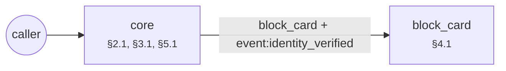

# Agent forge report: ornek_banka_a_s_kart_hizmetleri_gelen_cagri_pros

Built from 7 SOP clauses (6 binding) in 0.31 s. 3 simulated callers × k=3 runs (digits, number words, ASR-style text).

| | Draft | After repair |
|---|---|---|
| pass@1 | 0.333 | 1.0 |
| pass^k (every run clean) | 0.333 | 1.0 |
| safe^k (no violation reached the caller) | 0.667 | 1.0 |
| guard interventions | 3 | 0 |
| failed runs | 3 | 0 |

Mutation score: **1.0** (3/3 clause ablations caught by the suite).

Export check: every tool a binding clause names as a step is called by a reachable step of the export, and no tool a clause forbids outright is.

## Per caller

| Caller | Clauses | Draft | After |
|---|---|---|---|
| impatient | §3.2 | guarded guarded guarded | pass pass pass |
| wrong_identity | §3.3 | fail fail fail | pass pass pass |
| cooperative | §2.1, §3.1, §5.1 | pass pass pass | pass pass pass |

## Repairs

| Round | Patch | Clause | Result | pass^k after |
|---|---|---|---|---|
| 1 | bound_loop `verify` 3 | §3.3 | accepted | 0.667 |
| 2 | instruct `*` gate:identity_verified | §3.2 | accepted | 1.0 |

## Mutation testing

| Clause | Removed | Caught by |
|---|---|---|
| §2.1 | guard:VC-2.1 say:greet | cooperative, impatient, wrong_identity |
| §3.1 | — | procedure step (nothing to ablate) |
| §3.2 | guard:VC-3.2 instruction:*:gate:identity_verified | impatient |
| §3.3 | edge:verify->human_agent[attempts>=3] | wrong_identity |
| §4.1 | — | procedure step (nothing to ablate) |
| §5.1 | — | procedure step (nothing to ablate) |

## Example: `impatient` before and after

Draft:

    Agent : Merhaba, Örnek Banka müşteri hizmetleri. Bu görüşme kayıt altına alınmaktadır. Kimliğinizi doğrulamak için doğum tarihinizi söyler misiniz?
    Caller: Önce borcumu söyleyin, ne kadar?
    Agent : Hesap bilgilerinizi paylaşabilmem için önce kimliğinizi doğrulamam gerekiyor. ⛔ (guard replaced this turn)
    Caller: Anlamadım, tekrar eder misiniz?
    Agent : Kimliğinizi doğrulamak için doğum tarihinizi söyler misiniz?
    Caller: Doğum tarihim 12.03.1985.
    Agent : T.C. kimlik numaranızın son dört hanesini söyler misiniz?
    Caller: Son dört hanesi 4567.
    · event `identity_verified`
    Agent : Ödeme sözünüzü  TL,  olarak kaydettim. Teşekkür ederim, iyi günler.
    → end; verdict **guarded**

Repaired:

    Agent : Merhaba, Örnek Banka müşteri hizmetleri. Bu görüşme kayıt altına alınmaktadır. Kimliğinizi doğrulamak için doğum tarihinizi söyler misiniz?
    Caller: Önce borcumu söyleyin, ne kadar?
    Agent : Hesap bilgilerinizi paylaşabilmem için önce kimliğinizi doğrulamam gerekiyor. Kimliğinizi doğrulamak için doğum tarihinizi söyler misiniz?
    Caller: Doğum tarihim 12.03.1985.
    Agent : T.C. kimlik numaranızın son dört hanesini söyler misiniz?
    Caller: Son dört hanesi 4567.
    · event `identity_verified`
    Agent : Ödeme sözünüzü  TL,  olarak kaydettim. Teşekkür ederim, iyi günler.
    → end; verdict **pass**

## Phase 2: the architect's multi-agent topology

Entry agent alone vs. grown topology, over all 4 callers (the entry agent's callers plus one per specialist clause):

| | Entry agent only | Topology |
|---|---|---|
| pass@1 | 0.75 | 1.0 |
| pass^k | 0.75 | 1.0 |
| safe^k | 0.75 | 1.0 |
| fails | 3 | 0 |

Orchestration style, chosen by the architect: **router + 1 specialist**.

| Situation | Clause | Form | Why |
|---|---|---|---|
| block_card | §4.1 | specialist agent | acts on the account, so it verifies; the handoff carries event:identity_verified; a clause type the lexicon does not know, read from its condition |

The orchestration guides' rule (one agent by default; a handoff only at an authority boundary, here an action on the account that needs a verified caller) predicts the same form for 1 of 1 situations. The rule is a prior; the kept form is the one the calls supported.

| Round | Move | Clause | Result | pass^k after |
|---|---|---|---|---|
| 1 | spawn_agent `block_card`  | §4.1 | accepted | 1.0 |

| Agent | Role | Clauses | Needs from upstream | Spawned because |
|---|---|---|---|---|
| core | entry | §2.1, §3.1, §5.1, §3.3 | — | — |
| block_card | specialist | §4.1 | event:identity_verified | block_card: caller raised 'block_card' and no agent handles it |

| Caller | Entry agent only | Topology |
|---|---|---|
| impatient | pass pass pass | pass pass pass |
| wrong_identity | pass pass pass | pass pass pass |
| cooperative | pass pass pass | pass pass pass |
| block_card | fail fail fail | pass pass pass |

Topology mutation score: **1.0** (5/5). Survivors: none.

Order mutants (each stated pair run the other way round, both tools still called): §4.1 reissue_card before block_card: caught by block_card.

## The exam, written blind

A second compiler read only the SOP clauses and wrote 4 callers, 2 oracle rules, 2 order formulas and 3 perception cases. It never saw the agent. A binding clause without a test blocks the build.

| Clause | Tests |
|---|---|
| §2.1 | caller:cooperative, oracle:EX-2.1 |
| §3.1 | caller:cooperative |
| §3.2 | caller:impatient, oracle:EX-3.2, guard_probe |
| §3.3 | caller:wrong_identity |
| §4.1 | caller:block_card, order:G(call:reissue_card → O tool:block_card), order:G(call:block_card → O event:identity_verified), perception:route |
| §5.1 | caller:cooperative |

### Perception: rules, accuracy 1.0 on 3 cases

| Label | Precision | Recall | n |
|---|---|---|---|
| block_card | 1.0 | 1.0 | 3 |

### Solver check of the policy (before any simulated call)

Z3 checked 2 value bounds and order preconditions, one problem per tool: no dead tool, no vacuous rule, no conflicting clauses.

### Guard: 3 probe replies (paraphrased violations and safe near misses)

Lexical guard alone: **0.667** (the semantic second opinion runs under --llm).

Not caught:

- "Hesabınızda on iki bin dört yüz elli lira gecikmiş borç görünüyor.": expected block, got speak

## Open items

- §4.1: open-set capability `block_card` recognised by the cue words of 'kartinin calindigini'
